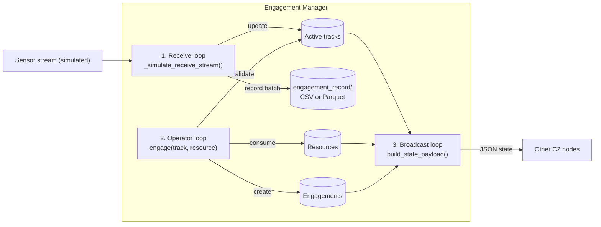

# Engagement Manager

A simulated **engagement node** for a command & control (C2) network, written in Python with `asyncio`.
It ingests track updates, lets an operator pair a track with a resource (an *engagement*), records every batch to disk, and broadcasts system state as JSON.

[](https://github.com/Viepertech/Engagement_Manager/actions/workflows/ci.yml)

> Originally written as requested code for a job interview, then extended with tests, CI, a container image and Parquet output.
> All tracks, positions and data are **fictional** and generated by the simulator.

## How it works

Three loops run concurrently with `asyncio.gather`:



| Concept | Meaning |
| --- | --- |
| **Track** | A fictional object detected by sensors; its position and classification update over time. |
| **Resource** | A finite pool of assets (interceptors, support units) that operators commit to actions. |
| **Operator** | The human user who monitors tracks and makes tactical decisions. |
| **Engagement** | An operator decision that pairs a specific track with a resource. It is refused if the track is not active or no resource is left. |

## Quick start

Requires Python 3.11+. The default CSV mode uses only the standard library.

```bash
python3 Engagement_Manager.py                 # CSV records in ./engagement_record
```

Parquet output (typed, columnar) needs `pyarrow`, installed in a virtual environment:

```bash
python3 -m venv .venv
source .venv/bin/activate                    # Windows: .venv\Scripts\activate
pip install -r requirements-optional.txt     # pyarrow
python Engagement_Manager.py --format parquet
```

Options: `--format csv|parquet`, `--record-dir PATH`, or the environment variables `RECORD_FORMAT` and `ENGAGEMENT_RECORD_DIR`.
If `--format parquet` is requested without `pyarrow`, the node logs a warning and falls back to CSV. Stop it with `Ctrl+C`.

### Docker

```bash
docker build -t engagement-manager .
docker run --rm -it -v "$PWD/engagement_record:/app/engagement_record" engagement-manager
```

The image runs as a non-root user and writes Parquet records by default.

## Sample output

```text
[INFO] Engagement Manager initializing (records: csv -> engagement_record)
[INFO] Updated state with 2 tracks.
[INFO] Successfully wrote CSV file: engagement_record/engagement_20261111_182925_251927.csv
[INFO] [BROADCAST] State published -> {"active_engagements": {}, "remaining_resources": {"interceptors": 10, "support_units": 5}, "tracked_objects_count": 2}
[INFO] --- OPERATOR ACTION --- Initiated ENG-1 on TRK-101 using interceptors
[INFO] [BROADCAST] State published -> {"active_engagements": {"ENG-1": {"track_id": "TRK-101", "resource_type": "interceptors", "status": "Initiated", ...}}, "remaining_resources": {"interceptors": 9, "support_units": 5}, "tracked_objects_count": 2}
[INFO] Engagement Manager shut down by operator.
```

Each batch becomes one UTC-timestamped file with the columns
`timestamp, track_id, classification, validity, position_x, position_y`.

## Design decisions

- **`asyncio` instead of threads.** The three loops spend most of their time waiting (on the network, the operator, a timer), so cooperative concurrency keeps the state simple: no locks are needed because only one coroutine runs at a time.
- **CSV by default, Parquet when available.** CSV needs no install and is human-readable. Parquet stores typed columns (a real UTC timestamp, floats) and compresses well, which matters once the record grows; `load_parquet_records()` reads every snapshot back into one table for analysis. Keeping CSV as the fallback means the node always runs, even where packages cannot be installed.
- **Validation before state changes.** `engage()` checks the track and the resource *before* decrementing anything, so a refused request leaves the system unchanged (covered by tests).
- **Unique file names.** Snapshots are stamped to the microsecond so two batches in the same second never overwrite each other.

## Testing and CI

```bash
pip install -r requirements-dev.txt
ruff check .                 # lint
bandit -q -r Engagement_Manager.py   # static security scan (SAST)
pytest -q                    # 13 unit tests, including the Parquet round trip
```

GitHub Actions runs lint, the security scan and the tests on Python 3.11 to 3.13, runs the tests again **without** `pyarrow` to prove the zero-dependency path, and builds the Docker image.

## Roadmap

- [ ] Replace the simulated stream with real sockets: receive on port 5555, broadcast on 5556 (both are already reserved in the constructor).
- [ ] Store records in SQLite as well, with sample SQL queries.
- [ ] A small REST endpoint and web dashboard showing live tracks and engagements.
- [ ] Engagement lifecycle beyond `Initiated` (in progress, complete, aborted) with resources returned on abort.

## Author

Alexander RN Murphy · [GitHub](https://github.com/Viepertech) · [LinkedIn](https://linkedin.com/in/alexanderrnmurphy)
